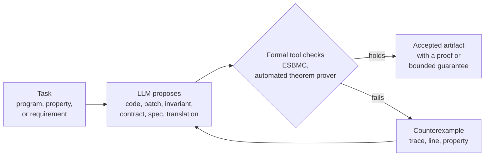
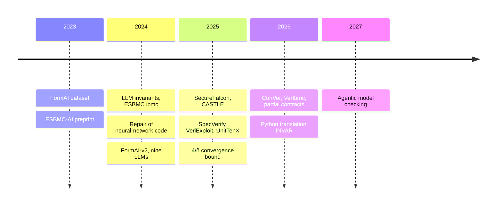

A language model can produce a loop invariant, a function contract or a patch in seconds. It cannot tell you whether any of those things is actually correct. A model checker can. Unwinding assertions confirm that a loop bound covers every iteration, k-induction proves properties of unbounded executions, and ranking functions prove that loops terminate. The checker still needs a property to verify, and for deep/nested loops and large codebases the proof often depends on an invariant or contract that no one has written. Each side fills a gap in the other.

Since 2023 our [Systems and Software Security (S3) group](https://www.cs.manchester.ac.uk/research/expertise/systems-and-software-security/) at the University of Manchester and our collaborators have looked at what happens when the two share a loop. Much of this work has used [ESBMC](https://github.com/esbmc/esbmc), the SMT-based model checker that we develop. ESBMC combines abstract interpretation through interval analysis, model checking through bounded model checking and k-induction, deductive verification through function contracts , and SMT solving. A recent survey looks at how it has become the verification backend for LLM based tools .

*Figure 1. The loop shared by most of the papers below. The LLM never makes the correctness decision; the formal tool does.*

## Our work since 2023

### 1. Verification as ground truth for LLM-generated code

We started off by asking how often LLM-written code is unsafe, and used ESBMC to find out. In the [FormAI dataset](https://github.com/FormAI-Dataset/FormAI-dataset) 51.24% of the 112,000 C programs from GPT-3.5-turbo had at least one vulnerability . Running the same study across 9 LLMs produced FormAI-v2 with 331,000 programs of which at least 62.07% were found to be vulnerable . FormAI was then used as training data for SecureFalcon, a 121M parameter classifier that achieved 94% binary accuracy . The [CASTLE benchmark](https://github.com/CASTLE-Benchmark/CASTLE-Benchmark) evaluates ESBMC against 13 static analyzers and 10 LLMs on 250 programs covering 25 CWEs. ESBMC had the lowest number of false positives but is unable to detect certain classes of vulnerability (e.g. weak crypto); the LLMs in general deteriorated as the size of the programs increased . A survey paper covers the wider area .

### 2. Counterexample-guided repair and generation

A counterexample is also a very good bug report so we pass it back to an LLM. [ESBMC-AI](https://github.com/esbmc/esbmc-ai) (posted May 2023) takes the source code, the counterexample and the stack trace and feeds it to an LLM, and ESBMC then re-verifies the patch. It was evaluated on 50k FormAI programs . ESBMC-AI has since been succeeded by [Entoli](https://byterepair.io/products/entoli/), an open-source agent with formal-verification-based workflows. The same loop is able to fix memory safety bugs in around 81k neural network implementations . VeriExploit runs it in reverse: you start with a Solidity counterexample and an LLM generates an attacker contract which re-triggers the bug. That contract is then validated by a model checker and is able to reproduce 88.46% of the bugs in our benchmark . [UnitTenX](https://github.com/cnunescoelho/UnitTenX) takes ESBMC counterexamples and turns them into readable unit tests for legacy C code .

### 3. LLMs supply what the verifier is missing

Here the LLM writes out the invariants and contracts that a proof needs, and a sound tool then decides whether to believe them.

- **Invariants.** ESBMC ibmc replaces each loop with an LLM-generated invariant which a theorem prover then checks. It was able to verify programs that SeaHorn and VeriAbs were unable to verify and went on to receive an ACM SIGSOFT Distinguished Paper Award . VerIbmc takes the same approach using open weight models on a single local machine and solves 431 of the 499 problems .
- **Contracts.** ConVer takes a top level property and synthesizes function contracts from it, refining them in a CEGAR-CEGIS loop and achieving 82-96% success on 45 Frama-C programs . For regression verification, partial LLM inferred contracts produced zero false equivalence proofs on EqBench-C .
- **Agents.** Agentic model checking is based on the principle of 'agents propose, solvers verify' where the agent works out the specifications and plans the run, with all soundness critical decisions remaining with the bounded model checker (CBMC and Kani). On mature, heavily fuzzed software it found 68 source-audited defects across 11 projects .

### 4. From prose and other languages to checkable models

SpecVerify uses Claude 3.5 Sonnet in conjunction with ESBMC to derive properties from requirements. On nine of Lockheed Martin's cyber-physical systems it achieved the same result as NASA's CoCoSim but with fewer false positives (though the models occasionally misread the specs, so human review was still required) . INVAR takes a document (e.g. the USB 2.0 or CXL 4.0 specification) and extracts a transition system from it, which it then checks with NuSMV and reports any missing evidence as a named gap rather than a vacuous pass . With NASA JPL we use an LLM to translate Python into C for ESBMC. The paper makes the caveat that as the translation doesn't prove equivalence the outcome is only bug finding and not verification ; the [agent and benchmark](https://github.com/esbmc/esbmc-python-cpp/tree/main/agent) are both public.

### 5. Making the loop itself predictable

An LLM inside a pipeline makes the pipeline's own behavior a question. The 4/δ bound shows that a four stage LLM verifier pipeline will reach a verified state almost surely and will require at most 4/δ expected iterations (90,000 trials all agreed with this) . Two reviews are associated with this work: one which provides a taxonomy of the generative transformations and their recurring patterns in over 100 LLM based proposals for software verification and falsification , and one which is a systematic review of 38 studies on LLM agents, which identifies specification as the bottleneck rather than checking .

## How the pieces fit together

*Figure 2. Timeline by publication year, or by first preprint for ESBMC-AI and for work not yet at a venue.*

The papers all follow the same pattern of division of labor. The LLM does the semantic guessing (what a loop maintains, what a function assumes, what a requirement means). A sound tool provides the guarantee. Over time the LLM has been trusted to do more and more. It started off just being measured, then it was used to repair code under a whole-program verifier, then it was used to write parts of the proof and in the agentic model checking work it's used to plan the entire run. Soundness never moves, every candidate is re-checked. A number of the papers are also direct extensions of one another. FormAI provided the evaluation set for ESBMC-AI and the training data for SecureFalcon and VerIbmc builds on the ibmc invariant work.

The negative results are just as important as the positive ones. CASTLE shows us the limitations of the formal tools. SpecVerify shows that the prose still requires a human to read it. The Python work is very clear in that an unverified translation will result in bugs rather than proofs.

## Lessons learned

Benchmarks come with an answer key; production code does not. In recent work an LLM agent drafted verification harnesses for codebases such as the AWS SDK for C++, NVIDIA OpenSMA firmware and vLLM, ESBMC checked them, and maintainers merged 18 fixes upstream, including two CVEs in the AWS SDK for C++. Five lessons from that work and the papers above, presented at [FATTW 2026](https://ssvlab.github.io/lucasccordeiro/talks/fattw2026_slides.pdf):

1. **Zero false positives beats a higher proof rate.** Developers stop trusting a tool that raises false alarms.
2. **Maintainers fix what arrives with a concrete input.** The counterexample is the bug report.
3. **The generator's quality still propagates.** With GPT-4o instead of Claude 3.5 Sonnet, SpecVerify produced 8 false positives instead of 0.
4. **We do not win every benchmark.** SeaHorn proves more programs than ibmc, and CoCoSim matches SpecVerify; portfolios beat single tools.
5. **Verifiers have traps too.** Zero verification conditions, disabled unwinding assertions and contracts that silently check nothing all look like success, so the evidence itself needs checking.

## What comes next

The talk closes with three challenges that neither academia nor industry can solve alone:

- **Verification at generation speed.** Agents generate code in seconds, while industrial proofs take minutes to hours, so checking must reuse earlier proofs incrementally.
- **Guarantees for agent workflows.** Verifying each agent is not enough to verify the workflow they form; we need compositional contracts between agents.
- **Evidence we can trust.** DO-178C already accepts formal evidence through DO-333, which raises the question of who checks the checker. Witnesses and validators are part of the answer.

Underneath all three sits the problem that every line of work above runs into: how do we validate a specification an LLM has derived from natural language before anything is proved against it?

## Join us

We're looking for PhD students, postdocs and collaborators who are interested in working on these problems (formal methods, program analysis, machine learning etc). Our tools are open source and most of the papers listed above come with the associated artifacts so you can run them. If this is of interest to you then just get in touch with [Lucas Cordeiro](mailto:lucas.cordeiro@manchester.ac.uk) with a brief note on what you'd like to work on.

## References

