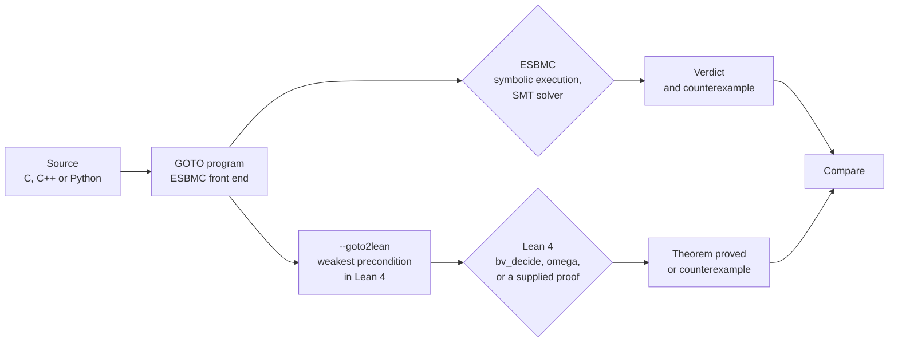

A model checker reports one of three verdicts: safe, unsafe or unknown. ESBMC prints them as `VERIFICATION SUCCESSFUL`, `VERIFICATION FAILED` and `VERIFICATION UNKNOWN`. An unknown verdict claims neither safety nor a violation; it leaves open why the method could not decide, for example because it ran out of time or the induction did not converge. An unsafe verdict is easy to validate: it comes with a counterexample, a concrete trace that can be replayed against the program. A safe verdict is harder to validate. It's the result of a parser, a symbolic execution engine, a simplifier, an SMT encoding and a solver all working in sequence. A defect in any one of those components can cause an incorrect program to be reported as safe. Our [last post](https://ssvlab.github.io/lucasccordeiro/blog/2026/llms-propose-verifiers-check/) ended with the question of who checks the checker. This post is about one answer we've started to build.

[ESBMC](https://github.com/esbmc/esbmc) is the SMT-based model checker that we've developed . It has front ends for C, C++, Python, Solidity and ladder diagrams which all produce the same intermediate language (the GOTO program), and it can also read Rust via Kani and Java programs via JBMC through our CBMC adapter. We've added a prototype back end, `--goto2lean`, which takes the GOTO program and prints out the corresponding [Lean 4](https://lean-lang.org/) definitions together with a theorem that no assertion fails. So far we have run this back end on C, C++ and Python programs only. ESBMC and Lean arrive at their conclusions via very different routes so we can compare them.



*Figure 1. Two routes from the same GOTO program. Agreement supports the verdict; a disagreement means that one of the two routes has a defect.*

The prototype is under review as [esbmc/esbmc#10539](https://github.com/esbmc/esbmc/pull/10539). It's only a scalar fragment: Booleans and fixed-width integers, structured control flow, non-recursive calls, single loops and quantifiers in assertions and assumptions. All the output below is from ESBMC 8.6.0 built from that branch and from Lean 4.35.0.

## What we built

### 1. Same bug, same counterexample

We start with the midpoint function that an LLM, or a person, writes first:

```c
#include <assert.h>
unsigned nondet_uint(void);
unsigned mid(unsigned lo, unsigned hi) {
  return (lo + hi) / 2;
}
int main(void) {
  unsigned lo = nondet_uint(), hi = nondet_uint();
  __ESBMC_assume(lo <= hi);
  unsigned m = mid(lo, hi);
  assert(lo <= m && m <= hi);
  return 0;
}
```

ESBMC reports `VERIFICATION FAILED` with `lo = hi = 4294967295`: the sum wraps and `m` becomes 2147483647. Running `esbmc mid.c --goto2lean --output mid.lean` produces this file:

```lean
def mid (lo : BitVec 32) (hi : BitVec 32) (post : BitVec 32 → Prop) : Prop :=
  post (BitVec.smtUDiv (lo + hi) (2#32))

def main (post : BitVec 32 → Prop) : Prop :=
  ∀ lo : BitVec 32,
  ∀ hi : BitVec 32,
  (lo ≤ hi) →
  mid lo hi (fun m =>
  -- assertion lo <= m && m <= hi
  ((lo ≤ m) ∧ (m ≤ hi)) ∧ (
  post (0#32)))

theorem main_safe : Prog.main (fun _ => True) := by
  simp only [Prog.mid, Prog.main]
  repeat' (first | apply And.intro | intro)
  all_goals bv_decide
```

*Listing 1. The generated Lean for `mid.c` (with the namespace and the `let` lines for renaming removed for space).*

Each function takes a postcondition and returns a proposition (its weakest precondition). A non-deterministic value becomes `∀`, an assumption becomes `→`, an assertion becomes `∧` and a call passes the rest of the program as a continuation. Lean rejects the theorem and prints its own counterexample:

```
error: The prover found a counterexample, consider the following assignment:
hi = 4294967295#32
lo = 4294967295#32
```

Two tools, two decision procedures, one input that breaks the program.

### 2. The fix, proved automatically

Replacing the body with `lo + (hi - lo) / 2` gives `VERIFICATION SUCCESSFUL` in ESBMC and Lean accepts the generated theorem with no further human input. The tactic `bv_decide` bit-blasts the goal, runs a SAT solver and then checks the solver's certificate within Lean. The same is true for the C file with early returns and if/else branches and for the repaired midpoint written in C++.

### 3. Loops: the invariant is checked, not trusted

```c
unsigned n = nondet_uint();
unsigned s = 0, i = 0;
while (i < n) { s = s + 1; i = i + 1; }
__ESBMC_assert(s == n, "s counts the iterations");
```

Plain k-induction gives `VERIFICATION UNKNOWN` on this loop. With the invariant `s == i && i <= n` ESBMC's `--loop-invariant-check` succeeds. The translator does not unwind the loop. It defines the loop in Lean as a recursive predicate (a greatest fixpoint, declared with `coinductive_fixpoint`) that covers any number of iterations. Proving a property of such a predicate requires a loop invariant. The translator does not guess one, so the generated theorem ends in `sorry`, Lean's placeholder for a missing proof. When we supply the same invariant as above, Lean checks that it holds on entry, is preserved by the loop body and implies the assertion on exit, and the theorem is proved.

The useful case is the wrong invariant. With the weaker `s = i`, Lean rejects it and reports a concrete counterexample state: `s = i = 4294967295`, `n = 2147483647`. That's the pattern we saw in our previous work on LLM-generated invariants : someone (a model or a human) proposes an invariant and a prover then decides whether to accept it. In this case two provers are making the decision and they agree.

Quantified assertions are translated too: `__ESBMC_forall` and `__ESBMC_exists` map directly to Lean's `∀` and `∃`. A universally quantified assertion is proved automatically, because the proof script introduces the bound variable and `bv_decide`, which only decides quantifier-free bit-vector goals, handles the rest. An existential assertion needs a witness, and none of the built-in tactics that we tried (`bv_decide`, `grind`, `simp`, `bv_omega`) finds it. For those the translator emits `sorry` again, and in our example a six-line manual proof, which gives the witness, discharges it. A file that contains `sorry` is reported as not proved.

### 4. One translator, three front ends

As the translation is from the GOTO program it also applies to programs from ESBMC's Python front end :

```python
def half(n: int) -> int:
    return n // 2

def check(n: int) -> bool:
    __ESBMC_assume(-1000 <= n and n <= 1000)
    assert half(-n) == -half(n)
    return True
```

The assertion holds if `//` truncates (as in C). In Python it floors, so the assertion is violated. ESBMC reports `VERIFICATION FAILED`, Lean returns the counterexample `n = 18446744073709551615#64` (i.e. -1 printed as an unsigned 64-bit integer) and CPython agrees: `-1 // 2` is -1 whereas `-(1 // 2)` is 0. A version that rounds towards zero for negative `n` is verified by ESBMC and proved by Lean.

Python integers are unbounded, and ESBMC supports them with `--ir`, which encodes integers as mathematical integers instead of fixed-width bit-vectors. The translator follows the selected encoding: with `--ir`, integers become Lean's `Int` and the `omega` tactic, in place of `bv_decide`, proves the Python midpoint correct for all inputs.

### 5. Rejected, not guessed

```
$ esbmc array.c --goto2lean
ERROR: goto2lean: unsupported type array
```

Arrays, pointers, recursion, nested loops, loops containing calls and ESBMC intrinsics are all outside the fragment. For those the translator reports an error, exits with status 1 and produces no output file. A translator that silently approximated an unsupported construct would produce a Lean theorem about a different program, and a proof of that theorem would say nothing about the original one.

## How the pieces fit together

Independent checking of ESBMC results is nothing new. ESBMC writes out [verification witnesses](https://gitlab.com/sosy-lab/benchmarking/sv-witnesses) for both violations and proofs and in [SV-COMP](https://sv-comp.sosy-lab.org/) the validators from other teams check those. The Lean route introduces a second type of evidence: a theorem about the program which is then checked by a proof assistant. It is worth stating precisely what each piece of that evidence trusts.

| Component | Shared by both routes? | Who checks it |
|---|---|---|
| Front end and GOTO conversion | Yes | Neither route; a front-end bug is invisible to both |
| Symbolic execution, simplifier, SMT encoding, solver | ESBMC only | The Lean route, by disagreeing |
| `--goto2lean` translator | Lean only | Trusted; it is not verified |
| `bv_decide` proofs | Lean only | Lean's kernel, plus compiled code that checks the SAT certificate |
| `omega` and hand proofs | Lean only | Lean's kernel |

The fourth row can be made precise. `#print axioms` on a theorem closed by `bv_decide` lists Lean's three standard axioms plus one or more axioms called `_native.bv_decide`. The native certificate checker runs as compiled code so the trusted base of the proof includes Lean's compiler as well as its kernel. The `Int` proof of the unbounded midpoint only relies on the three standard axioms.

The generated theorem is about partial correctness: no ESBMC assertion fails on any terminating execution. ESBMC's own checks (e.g. overflow, division by zero) are expressed as assertions in the GOTO program and are treated in exactly the same way as any other assertion. Termination is not part of the theorem.

The check is inexpensive on these programs. As the median of three runs on an Apple silicon laptop with a Debug build of ESBMC, the translation took 0.4s for the C and C++ files and 1.3s for the Python files and Lean checked each of the generated files in 1.6 to 2.3s. These are ten small programs and say nothing about scalability.

## Lessons learned

1. **Agreement is evidence not proof.** The two routes have the same front end and the translator is unverified. Agreement rules out a class of defects in the engine and solver; it does not rule out all defects.
2. **Disagreements are the payoff.** Under `--ir`, Lean's `Int` never wraps. Whilst building this mode we discovered that ESBMC's simplifier still folded constant arithmetic with fixed-width wraparound under `--ir` so the same program could end up with different verdicts depending on whether or not the operand was a constant ([#10537](https://github.com/esbmc/esbmc/issues/10537), fixed in [#10576](https://github.com/esbmc/esbmc/pull/10576)). That defect is now fixed in ESBMC.
3. **Refusing is a feature.** An unsupported construct results in an error and an unproven goal results in a visible `sorry`. Neither can be mistaken for a successful proof.
4. **Say what the proof trusts.** "Checked by Lean" means different things for `bv_decide` and `omega`. The axiom list is part of the result.
5. **The encoding is part of the claim.** A proof over fixed-width bit-vectors and a proof over unbounded integers are different theorems. The translator follows the encoding that ESBMC was asked to use, so both tools answer the same question, and that encoding has to match the language being verified.

## What comes next

- **A larger fragment.** Arrays and pointers come first as most of the C code that we verify makes use of them. They require a memory model in Lean that corresponds to ESBMC's.
- **A second route to Lean.** ESBMC can also generate its verification conditions as SMT-LIB 2 files and [LeanWuzla](https://github.com/hargoniX/Leanwuzla) can then check the bit-vector problems of that type with `bv_decide`. We haven't yet run it on ESBMC's output. That route would check the solver's answer, whereas `--goto2lean` would check the program.
- **LLM-proposed invariants, checked twice.** The loop example has exactly one gap (the invariant). We're going to have an LLM fill that in and only accept the result if Lean then goes on to close the proof.
- **A smaller trusted base.** The translator is the weakest link in the table above. We can reduce what it must be trusted for, or prove properties of it.

The question from the last post is now in even sharper form: how much of a verifier's answer can we actually turn into evidence that a small, independent checker can validate?

## Join us

We're looking for PhD students, postdocs and collaborators who are interested in working on these problems (formal methods, program analysis, interactive theorem proving etc). ESBMC is open source and the prototype, its regression tests and its documentation are all in the [pull request](https://github.com/esbmc/esbmc/pull/10539). If this is of interest to you then just get in touch with [Lucas Cordeiro](mailto:lucas.cordeiro@manchester.ac.uk) with a quick note on what you'd like to work on. If you'd like to talk to the group first then please join our public [Zulip chat](https://systemsandsoftwaresecurity.zulipchat.com/join/6ajabxaurkcwl6tl3ify55jv/).

## References

<style>ul.bibliography{list-style:none;padding-left:0}ul.bibliography li{margin-bottom:.6em}</style>


