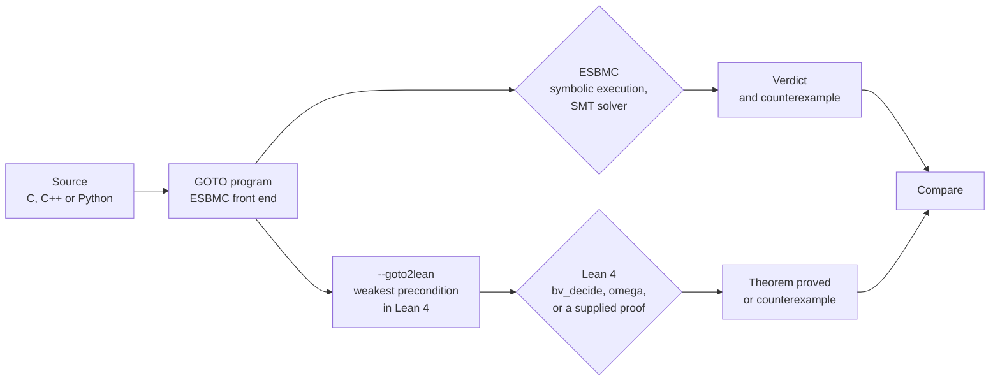

A model checker ends its run with one line: `VERIFICATION SUCCESSFUL` or `VERIFICATION FAILED`. A failure is easy to believe, because it comes with a counterexample that you can replay. A success is harder. It rests on a parser, a symbolic execution engine, a simplifier, an SMT encoding and a solver, and a defect in any of them can turn a wrong program into a successful run. Our [previous post](https://ssvlab.github.io/lucasccordeiro/blog/2026/llms-propose-verifiers-check/) ended with the question of who checks the checker. This post is about one answer that we have started to build.

[ESBMC](https://github.com/esbmc/esbmc) is the SMT-based model checker that we develop . Its C, C++ and Python front ends all produce the same intermediate language, the GOTO program. We added a prototype back end, `--goto2lean`, that prints this GOTO program as [Lean 4](https://lean-lang.org/) definitions together with a theorem stating that no assertion fails. Lean then proves the theorem or refutes it with a counterexample. ESBMC and Lean reach their answers by different routes, so we can compare them.



*Figure 1. Two routes from the same GOTO program. Agreement supports the verdict; a disagreement means that one of the two routes has a defect.*

The prototype is under review as [esbmc/esbmc#10539](https://github.com/esbmc/esbmc/pull/10539). It covers a scalar fragment only: Booleans and fixed-width integers, structured control flow, non-recursive calls, single loops, and quantifiers in assertions and assumptions. All outputs below come from ESBMC 8.6.0 built from that branch and from Lean 4.35.0.

## What we built

### 1. Same bug, same counterexample

We start with the midpoint function that an LLM, or a person, writes first:

```c
#include <assert.h>
unsigned nondet_uint(void);
unsigned mid(unsigned lo, unsigned hi) {
  return (lo + hi) / 2;
}
int main(void) {
  unsigned lo = nondet_uint(), hi = nondet_uint();
  __ESBMC_assume(lo <= hi);
  unsigned m = mid(lo, hi);
  assert(lo <= m && m <= hi);
  return 0;
}
```

ESBMC reports `VERIFICATION FAILED` with `lo = hi = 4294967295`: the sum wraps around and `m` becomes 2147483647. Running `esbmc mid.c --goto2lean --output mid.lean` writes this file:

```lean
def mid (lo : BitVec 32) (hi : BitVec 32) (post : BitVec 32 → Prop) : Prop :=
  post (BitVec.smtUDiv (lo + hi) (2#32))

def main (post : BitVec 32 → Prop) : Prop :=
  ∀ lo : BitVec 32,
  ∀ hi : BitVec 32,
  (lo ≤ hi) →
  mid lo hi (fun m =>
  -- assertion lo <= m && m <= hi
  ((lo ≤ m) ∧ (m ≤ hi)) ∧ (
  post (0#32)))

theorem main_safe : Prog.main (fun _ => True) := by
  simp only [Prog.mid, Prog.main]
  repeat' (first | apply And.intro | intro)
  all_goals bv_decide
```

*Listing 1. The generated Lean for `mid.c`, with the namespace and renaming `let` lines removed for space.*

Each function takes a postcondition and returns a proposition, its weakest precondition. A nondeterministic value becomes `∀`, an assumption becomes `→`, an assertion becomes `∧`, and a call passes the rest of the program as a continuation. Lean rejects the theorem and prints its own counterexample:

```
error: The prover found a counterexample, consider the following assignment:
hi = 4294967295#32
lo = 4294967295#32
```

Two tools, two decision procedures, one input that breaks the program.

### 2. The fix, proved automatically

Replacing the body with `lo + (hi - lo) / 2` gives `VERIFICATION SUCCESSFUL` in ESBMC, and Lean accepts the generated theorem with no human input. The tactic `bv_decide` bit-blasts the goal, calls a SAT solver, and checks the solver's certificate inside Lean. The same happens for a C file with early returns and if/else branches, and for the repaired midpoint written in C++.

### 3. Loops: the invariant is checked, not trusted

```c
unsigned n = nondet_uint();
unsigned s = 0, i = 0;
while (i < n) { s = s + 1; i = i + 1; }
__ESBMC_assert(s == n, "s counts the iterations");
```

Plain k-induction returns `VERIFICATION UNKNOWN` on this loop. With the invariant `s == i && i <= n`, ESBMC's `--loop-invariant-check` succeeds. The translator turns the loop into a greatest fixpoint (`coinductive_fixpoint`) and leaves the theorem open with `sorry`, because it does not guess invariants. Supplying the same invariant to the loop's coinduction principle closes the proof in Lean.

The useful case is the wrong invariant. With the weaker `s = i`, Lean refuses and reports a concrete state: `s = i = 4294967295`, `n = 2147483647`. This is the pattern from our earlier work on LLM-generated invariants : a model or a person proposes the invariant, and a prover decides whether to believe it. Here two provers decide, and they agree.

Quantifiers behave in the same way. `bv_decide` only handles quantifier-free goals, so for a program that asserts `__ESBMC_exists` and `__ESBMC_forall` the translator again emits `sorry`, and a six-line hand proof closes it. A file that contains `sorry` is reported as not proved.

### 4. One translator, three front ends

Because the translation starts from the GOTO program, it also serves ESBMC's Python front end :

```python
def half(n: int) -> int:
    return n // 2

def check(n: int) -> bool:
    __ESBMC_assume(-1000 <= n and n <= 1000)
    assert half(-n) == -half(n)
    return True
```

The assertion holds if `//` truncates, as in C. In Python `//` floors, so it fails. ESBMC reports `VERIFICATION FAILED`, Lean returns the counterexample `n = 18446744073709551615#64`, which is -1 printed as an unsigned 64-bit value, and CPython agrees: `-1 // 2` is -1 while `-(1 // 2)` is 0. A version that rounds toward zero for negative `n` is verified by ESBMC and proved by Lean.

One caveat matters here. The translation follows ESBMC's model of Python, not Python itself. By default ESBMC models `int` as a 64-bit integer that wraps around, so the unbounded midpoint in Python gets a counterexample that cannot occur in a real interpreter. With `--ir`, ESBMC uses unbounded integers and the translator follows: integers become Lean's `Int`, and the `omega` tactic proves the midpoint correct for all inputs.

### 5. Rejected, not guessed

```
$ esbmc array.c --goto2lean
ERROR: goto2lean: unsupported type array
```

Arrays, pointers, recursion, nested loops, calls inside loops and ESBMC intrinsics are outside the fragment. For these the translator prints an error, exits with status 1 and writes no output file. A translator that silently approximated an unsupported construct would produce a Lean theorem about a different program, and a proof of that theorem would be worse than no proof.

## How the pieces fit together

Independent checking of ESBMC's results is not new. ESBMC writes [verification witnesses](https://gitlab.com/sosy-lab/benchmarking/sv-witnesses) for both violations and proofs, and in [SV-COMP](https://sv-comp.sosy-lab.org/) validators developed by other teams check them. The Lean route adds a second kind of evidence: a theorem about the program, checked by a proof assistant. It helps to state exactly what each part of that evidence trusts.

| Component | Shared by both routes? | Who checks it |
|---|---|---|
| Front end and GOTO conversion | Yes | Neither route; a front-end bug is invisible to both |
| Symbolic execution, simplifier, SMT encoding, solver | ESBMC only | The Lean route, by disagreeing |
| `--goto2lean` translator | Lean only | Trusted; it is not verified |
| `bv_decide` proofs | Lean only | Lean's kernel, plus compiled code that checks the SAT certificate |
| `omega` and hand proofs | Lean only | Lean's kernel |

The fourth row deserves a number. `#print axioms` on a theorem closed by `bv_decide` lists Lean's three standard axioms and one or more axioms named `_native.bv_decide`: the verified certificate checker runs as compiled code, so the proof trusts Lean's compiler as well as its kernel. The `Int` proof of the unbounded midpoint depends on the three standard axioms only.

The generated theorem states partial correctness: no ESBMC assertion fails on any terminating execution. ESBMC's own checks, such as overflow and division by zero, appear as assertions in the GOTO program and are translated like any other assertion. Termination is not part of the theorem.

The check is cheap on these programs. As the median of three runs on an Apple-silicon laptop, with a Debug build of ESBMC, the translation took 0.4 s for the C and C++ files and 1.3 s for the Python ones, and Lean checked each generated file in 1.6 to 2.3 s. These are ten small programs and say nothing yet about scale.

## Lessons learned

1. **Agreement is evidence, not proof.** The two routes share a front end, and the translator is unverified. Agreement rules out a class of defects in the engine and solver, not all defects.
2. **Disagreements are the payoff.** Under `--ir`, Lean's `Int` never wraps. While building this mode we found that ESBMC's simplifier still folds constant arithmetic with fixed-width wraparound under `--ir`, so the same program could get different verdicts depending on whether an operand was constant ([#10537](https://github.com/esbmc/esbmc/issues/10537), fix under review in [#10576](https://github.com/esbmc/esbmc/pull/10576)). Until that fix is merged, the integer mode requires `--no-simplify`.
3. **Refusing is a feature.** An unsupported construct produces an error, and an unproved goal produces a visible `sorry`. Neither can be mistaken for success.
4. **Say what the proof trusts.** "Checked by Lean" means different things for `bv_decide` and `omega`. The axiom list is part of the result.
5. **The model under verification is part of the claim.** Both tools agreed on a Python counterexample that Python cannot produce, because both followed the 64-bit model. Agreement between tools does not validate the model they share.

## What comes next

- **A larger fragment.** Arrays and pointers come first, since most of the C code that we verify uses them. They need a memory model in Lean that matches ESBMC's.
- **A second route to Lean.** ESBMC can also write its verification conditions as SMT-LIB 2 files, and [LeanWuzla](https://github.com/hargoniX/Leanwuzla) checks bit-vector problems of that kind with `bv_decide`. We have not yet run it on ESBMC's output. That route would check the solver's answer, while `--goto2lean` checks the program.
- **LLM-proposed invariants, checked twice.** The loop example leaves exactly one gap, the invariant. We plan to let a model fill it and to accept the result only when Lean closes the proof.
- **A smaller trusted base.** The translator is the weakest link in the table above. Reducing what it has to be trusted for, or proving properties of it, is open.

Underneath sits the question from the previous post, now in a sharper form: how much of a verifier's answer can we turn into evidence that a small, independent checker confirms?

## Join us

We're looking for PhD students, postdocs and collaborators who are interested in working on these problems (formal methods, program analysis, interactive theorem proving etc). ESBMC is open source, and the prototype, its regression tests and its documentation are in the [pull request](https://github.com/esbmc/esbmc/pull/10539). If this is of interest to you then just get in touch with [Lucas Cordeiro](mailto:lucas.cordeiro@manchester.ac.uk) with a brief note on what you'd like to work on. To talk with the group first, join our public [Zulip chat](https://systemsandsoftwaresecurity.zulipchat.com/join/6ajabxaurkcwl6tl3ify55jv/).

## References

<style>ul.bibliography{list-style:none;padding-left:0}ul.bibliography li{margin-bottom:.6em}</style>


