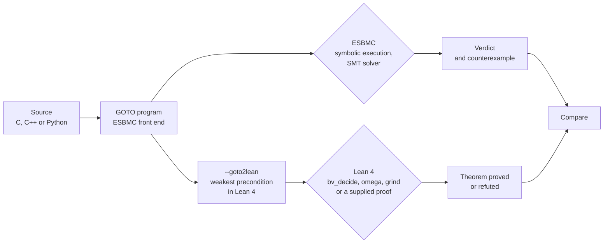

A model checker reports one of three verdicts: safe, unsafe or unknown. ESBMC prints them as `VERIFICATION SUCCESSFUL`, `VERIFICATION FAILED` and `VERIFICATION UNKNOWN`. An unsafe verdict is easy to validate, because it comes with a counterexample that can be replayed against the program. A safe verdict is harder. It is the output of a parser, a symbolic execution engine, a simplifier, an SMT encoding and a solver working in sequence, and a defect in any of them can make an incorrect program look safe. Our [last post](https://ssvlab.github.io/lucasccordeiro/blog/2026/llms-propose-verifiers-check/) ended by asking who checks the checker. This post reports on one answer we have started to build, and on what we found when we ran it.

[ESBMC](https://github.com/esbmc/esbmc) is the SMT-based model checker that we develop . Its front ends for C, C++, Python, Solidity and ladder diagrams all produce the same intermediate language, the GOTO program. A new back end, `--goto2lean`, prints the GOTO program as [Lean 4](https://lean-lang.org/) definitions together with a theorem stating that no assertion fails. It was merged into ESBMC master in [esbmc/esbmc#10539](https://github.com/esbmc/esbmc/pull/10539) and is documented in [`lean.md`](https://github.com/esbmc/esbmc/blob/master/website/content/docs/lean.md); it is not yet in a release. So far it covers a scalar fragment: Booleans and fixed-width or unbounded integers, structured control flow, non-recursive calls, single loops, and quantifiers in assertions and assumptions.



*Figure 1. Two routes from the same GOTO program. Both start after the front end, so a front-end bug is invisible to both.*

All results below come from ESBMC built from master (commit `d5d101811e`, a Debug build) and Lean 4.35.0 on an Apple silicon laptop, unless we say otherwise.

## A loop that neither SAT solver finishes

Here is a loop that sums the first `n` cubes and asserts Nicomachus's identity: the sum of the cubes equals the square of the sum.

```c
unsigned nondet_uint(void);
int main(void) {
  unsigned n = nondet_uint();
  unsigned s = 0, c = 0, i = 0;
  while (i < n) {
    s = s + i;
    c = c + i * i * i;
    i = i + 1;
  }
  __ESBMC_assert(c == s * s, "Nicomachus");
  return 0;
}
```

The identity is a polynomial equation, so it also holds modulo 2<sup>32</sup> and the assertion is true for every `n`. Plain k-induction cannot prove it. Given the invariant `2 * s == i * (i - 1) && c == s * s && i <= n` through `__ESBMC_loop_invariant`, ESBMC's `--loop-invariant-check` has to show, among other things, that adding `i * i * i` to `c` preserves `c == s * s`. Neither Z3 nor Bitwuzla returned a verdict within 300 seconds, and a harness containing only that inductive step also timed out at 120 seconds. Both solvers reduce bit-vector multiplication to propositional logic, and a 32-bit cubic is a large circuit.

`esbmc ucubes.c --goto2lean` turns the loop into a recursive Lean predicate, `main_loop1`, defined as a greatest fixpoint. The translator does not invent invariants, so the generated theorem ends in `sorry`. With the same invariant supplied by hand, the proof is:

```lean
theorem main_safe : Prog.main (fun _ => True) := by
  simp only [Prog.main]
  intro n
  apply Prog.main_loop1.coinduct n _ _
    (fun s c i => 2#32 * s = i * (i - 1#32) ∧ c = s * s ∧ i ≤ n)
  · intro s c i ⟨hs, hc, hle⟩
    refine ⟨fun hlt => ⟨?_, trivial⟩, fun hlt => ⟨?_, ?_, ?_⟩⟩
    · have : i = n := by bv_omega
      subst this; exact hc
    · grind
    · grind
    · bv_omega
  · exact ⟨by decide, by decide, by bv_omega⟩
```

*Listing 1. A Lean proof of the 32-bit Nicomachus loop. Lean checks it in 4.2 seconds.*

The two `grind` calls carry the step. `grind` includes a ring solver, and its trace shows it treating `BitVec 32` as a commutative ring: `+`, `-` and `*` are normalized as polynomials instead of turned into a circuit, so the cubic is no harder for it than the linear parts. Replacing `grind` with `bv_decide`, Lean's own bit-blaster, ends in a SAT solver timeout too; the gain comes from the algebra.

The same comparison flips over unbounded integers. With `--ir`, ESBMC encodes integers as mathematical integers, and Z3's nonlinear integer arithmetic proves the unbounded version of this loop from the same invariant in 0.46 seconds. It also proves `x * x >= 0` in 0.46 seconds. Lean's linear arithmetic tactic `omega` proves neither: the cubes step needs `grind`, and the square needs a four-line case split on the sign of `x` from Lean's core lemmas. Which prover wins depends on the encoding, and the rest of this post looks at that boundary.

## How the translation works

The midpoint function below has the familiar overflow bug.

```c
#include <assert.h>
unsigned nondet_uint(void);
unsigned mid(unsigned lo, unsigned hi) {
  return (lo + hi) / 2;
}
int main(void) {
  unsigned lo = nondet_uint(), hi = nondet_uint();
  __ESBMC_assume(lo <= hi);
  unsigned m = mid(lo, hi);
  assert(lo <= m && m <= hi);
  return 0;
}
```

ESBMC reports `VERIFICATION FAILED` with `lo = hi = 4294967295`: the sum wraps and `m` becomes 2147483647. `esbmc mid.c --goto2lean --output mid.lean` produces:

```lean
def mid (lo : BitVec 32) (hi : BitVec 32) (post : BitVec 32 → Prop) : Prop :=
  post (BitVec.smtUDiv (lo + hi) (2#32))

def main (post : BitVec 32 → Prop) : Prop :=
  ∀ lo : BitVec 32,
  ∀ hi : BitVec 32,
  (lo ≤ hi) →
  mid lo hi (fun m =>
  -- assertion lo <= m && m <= hi
  ((lo ≤ m) ∧ (m ≤ hi)) ∧ (
  post (0#32)))

theorem main_safe : Prog.main (fun _ => True) := by
  simp only [Prog.mid, Prog.main]
  repeat' (first | apply And.intro | intro)
  all_goals bv_decide
```

*Listing 2. The generated Lean for `mid.c`, with the namespace and the `let` lines for renaming removed.*

Each function takes a postcondition and returns its weakest precondition. A nondeterministic value becomes `∀`, an assumption `→`, an assertion `∧`, and a call passes the rest of the program as a continuation. Lean rejects the theorem and `bv_decide` prints `hi = 4294967295#32` and `lo = 4294967295#32`, the input ESBMC found. Feeding that input back to ESBMC as an assumption reproduces the failure with `m = 2147483647`.

Loops become greatest fixpoints, as in Listing 1, so the theorem states partial correctness: no assertion fails on a terminating execution. ESBMC's own checks for overflow or division by zero are assertions in the GOTO program and are translated like any other. Python goes through the same translator . By default ESBMC models a Python `int` as a 64-bit integer; with `--ir` the translator emits Lean's unbounded `Int` and the proof uses `omega` instead of `bv_decide`. Arrays, pointers, recursion, nested loops and calls inside loops are rejected with `ERROR: goto2lean: unsupported ...` and no output file, so an unsupported construct can never turn into a theorem about a different program.

## Where each prover is stronger

We ran a handful of small programs through both routes. The verdicts and times are single runs.

| Program | ESBMC | Lean via `--goto2lean` |
|---|---|---|
| `mid.c`, the overflow bug | `FAILED`, `lo = hi = 4294967295` | `bv_decide` refutes with the same values |
| `3*x + 5*y != 31` for `x`, `y` in 0..10, with `--ir` | `FAILED`, `x = 7`, `y = 2` | `omega` fails and prints a constraint over its internal `bmod_div_term` variables; in bit-vector mode `bv_decide` gives `x = 7`, `y = 2` |
| `x * x >= 0`, `--ir` | `SUCCESSFUL`, 0.46 s | `omega` and `grind` fail; 4-line case split |
| Gauss sum `2*s == n*(n-1)`, `--ir` | k-induction `UNKNOWN`; with the invariant, `SUCCESSFUL` in 0.47 s | same invariant plus `grind` |
| Nicomachus, `--ir` | k-induction `UNKNOWN`; with the invariant, `SUCCESSFUL` in 0.46 s; a wrong invariant is rejected | same invariant plus `grind` |
| Nicomachus, 32-bit | with the invariant, no verdict in 300 s from Z3 or Bitwuzla | Listing 1, 4.2 s |
| An assertion with `__ESBMC_exists` | `SUCCESSFUL`, automatic | needs a 6-line proof that supplies the witness |
| A counting loop with the too-weak invariant `s == i` | `UNKNOWN`: "loop invariant too weak to prove this claim" | refuted, with the state `s = i = 4294967295`, `n = 2147483647` |
| Arrays, pointers | supported | rejected |

ESBMC finds bugs and prints concrete inputs, handles the whole language, and with Z3 is strong on nonlinear integer arithmetic. Lean asks for more human input, but a proof it accepts is checked by its kernel, and it can use algebra where bit-blasting stalls.

Hand proofs are possible in ESBMC as well, and the 32-bit Nicomachus step shows what one costs. We split the step into four algebraic lemmas over nondeterministic `unsigned` values: expanding `(s + i) * (s + i)`, regrouping `2 * s * i`, substituting `2 * s` by `i * (i - 1)`, and expanding `i * (i - 1) * i + i * i`. Each lemma proves in under a second with both solvers. A fifth harness assumes those four instances and asserts the step; Z3 proves it in 0.53 seconds, while Bitwuzla returns no verdict within 120 seconds. Three more harnesses cover the invariant on entry, the preserved bound `i <= n`, and the assertion on exit. Two details made this harder than the count of eight harnesses suggests. The substitution lemma timed out in both solvers when we wrote it with `i * (i - 1)` directly and proved in 0.4 seconds once both sides were plain variables. And the induction rule that combines entry, step and exit into a proof for every `n` is our argument, not something ESBMC checks. In Lean, `Prog.main_loop1.coinduct` checks that rule.

## When the two disagree

Lean's `Int` never wraps. While building the `--ir` mode we found that ESBMC's simplifier still folded constant arithmetic with fixed-width wraparound under `--ir`, so a program could get different verdicts depending on whether an operand was a constant ([#10537](https://github.com/esbmc/esbmc/issues/10537), fixed in [#10576](https://github.com/esbmc/esbmc/pull/10576)). We kept a build from 12 November, before the fix, and used it to replay one of the regression tests from that issue:

```c
int nondet_int(void);
int main() {
  int x = nondet_int();
  __ESBMC_assume(x >= 0 && x <= 10);
  int y = x - 1 - 2147483647;
  __ESBMC_assert(y >= 0, "y >= 0");
  return 0;
}
```

Under `--ir`, `y` is at most −2147483638, so the assertion fails for every `x`. The old build says `VERIFICATION SUCCESSFUL`, the error the first paragraph of this post worried about: an unsafe program reported as safe.

Lean does not accept the translated theorem, but under `Int` its failure is weak evidence on its own: `omega` reports only that "a possible counterexample may satisfy the constraints 0 ≤ a ≤ 10". That range is still enough to settle the question without trusting Lean. We took `x = 0` from it and changed the assumption to `x == 0`. The old build then says `VERIFICATION FAILED`. A program that is safe for every `x` between 0 and 10 cannot be unsafe at `x = 0`, so ESBMC has contradicted itself, and the bug is in ESBMC. Running the old build again with `--no-simplify` gives `FAILED` for both versions, which points at the simplifier rather than the SMT encoding or the solver. Current master reports `FAILED` with `x = 0` and `y = -2147483648`, and Lean proves the negation of the theorem from that witness in four lines:

```lean
theorem main_unsafe : ¬ Prog.main (fun _ => True) := by
  intro h
  simp only [Prog.main] at h
  have := (h 0 (by omega)).1
  omega
```

The same replay does not work on every bug from that issue. In the test `y = ~b + INT_MIN`, the old build is wrong at `b = 0` as well, so fixing a point exposes nothing, and `--goto2lean` rejects `~` under `--ir`, so Lean has nothing to say. The cross-check only reaches programs that the translator accepts.

## What the Lean proof trusts

Independent checking of ESBMC results is not new. ESBMC writes [verification witnesses](https://gitlab.com/sosy-lab/benchmarking/sv-witnesses) for violations and proofs, and in [SV-COMP](https://sv-comp.sosy-lab.org/) other teams' validators check them. The Lean route adds a theorem about the program, checked by a proof assistant, and it is worth being exact about what that theorem relies on.

| Component | Shared by both routes? | Who checks it |
|---|---|---|
| Front end and GOTO conversion | Yes | Neither route; a front-end bug is invisible to both |
| Symbolic execution, simplifier, SMT encoding, solver | ESBMC only | The Lean route, by disagreeing |
| `--goto2lean` translator | Lean only | Trusted; it is not verified |
| `bv_decide` proofs | Lean only | Lean's kernel, plus compiled code that checks the SAT certificate |
| `omega`, `grind` and hand proofs | Lean only | Lean's kernel |

`#print axioms` on a theorem closed by `bv_decide` lists Lean's three standard axioms plus axioms named `_native.bv_decide`: the certificate checker runs as compiled code, so the trusted base includes Lean's compiler as well as its kernel. Proofs by `omega` and `grind` rely on the three standard axioms only.

The check is cheap on these programs. Over the medians of three runs on ten demo programs, translation took about 0.4 seconds for C and C++ and 1.2 seconds for Python (4.4 seconds for the Python program under `--ir`), and Lean checked each generated file in 1.5 to 1.7 seconds. Most of that is start-up of a Debug build; the numbers say nothing about scalability.

## What we learned

1. **The boundary between the provers follows the encoding.** Over unbounded integers, Z3 proved the square, the Gauss sum and Nicomachus in under half a second each, goals that `omega` cannot prove. Over 32-bit words, Z3, Bitwuzla and `bv_decide` all stalled on Nicomachus, and `grind` proved it in 4.2 seconds. Choosing the encoding chooses which prover is likely to succeed.
2. **Under `Int`, a failed Lean proof is not a counterexample.** `bv_decide` returns concrete values; `omega` returns constraints over its own internal terms, which nobody can replay. In that mode the work divides naturally: ESBMC finds the witness, and Lean certifies the refutation in a few lines.
3. **A disagreement is useful when one side's answer can be replayed in the other.** On #10537, a point from Lean's failed proof made ESBMC contradict itself, and toggling `--no-simplify` then isolated the component. Where no single point exposes the bug, or the translator rejects the program, the disagreement tells us much less.
4. **A hand proof in ESBMC checks the pieces, not the argument that joins them.** The Nicomachus proof took eight harnesses, depended on how one lemma was written, and went through with Z3 only. The induction rule connecting the harnesses stayed on paper. Lean checks that rule.

## What comes next

- **Prove the translator.** The translator is the trusted link in the table above. Rafael's PhD thesis, [*GOTO: a verification framework for CProver tools*](https://ssvlab.github.io/lucasccordeiro/supervisions/phd_thesis_rafael.pdf) (University of Manchester, 2025), gives GOTO a formal semantics, mechanized in part in Isabelle, and treats unwinding, slicing and common-subexpression elimination as transformation passes over it. With that semantics in Lean, we can state the translator's correctness as a theorem: the weakest precondition that `--goto2lean` emits implies that no assertion fails in any execution allowed by the semantics. The same semantics lets us state what #10537 broke: a pass must preserve the meaning of the program under the selected encoding.
- **A larger fragment.** Arrays and pointers come first, because most of the C code we verify uses them. They need a memory model in Lean that matches ESBMC's, and memory models are also outside the scope of the thesis's Isabelle formalization, so this work starts from the same gap.
- **LLM-proposed invariants, checked by the stronger prover.** The Nicomachus invariant is exactly the kind of input we ask a model to propose . When the SMT solvers stall on the step, as they did here, Lean can still check the proposal.
- **A second route to Lean.** ESBMC can write its verification conditions as SMT-LIB 2 files, and [LeanWuzla](https://github.com/hargoniX/Leanwuzla) can check bit-vector problems of that kind with `bv_decide`. We have not yet run it on ESBMC's output. That route would check the solver's answer; `--goto2lean` checks the program.

## Join us

We are looking for PhD students, postdocs and collaborators interested in these problems: formal methods, program analysis and interactive theorem proving. ESBMC is open source, and the translator, its regression tests and its documentation are in [ESBMC master](https://github.com/esbmc/esbmc). If this interests you, email [Lucas Cordeiro](mailto:lucas.cordeiro@manchester.ac.uk) with a short note on what you would like to work on, or talk to the group first on our public [Zulip chat](https://systemsandsoftwaresecurity.zulipchat.com/join/6ajabxaurkcwl6tl3ify55jv/).

## References

<style>ul.bibliography{list-style:none;padding-left:0}ul.bibliography li{margin-bottom:.6em}</style>


