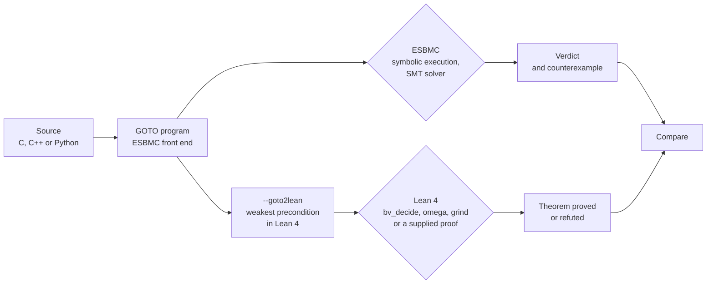

A model checker reports one of three verdicts: safe, unsafe or unknown. ESBMC prints them as `VERIFICATION SUCCESSFUL`, `VERIFICATION FAILED` and `VERIFICATION UNKNOWN`. An unsafe verdict is easy to validate, because it comes with a counterexample that can be replayed against the program. A safe verdict is harder. It is the output of a parser, a symbolic execution engine, a simplifier, an SMT encoding and a solver working in sequence, and a defect in any of them can make an incorrect program look safe. Our [last post](https://ssvlab.github.io/lucasccordeiro/blog/2026/llms-propose-verifiers-check/) ended by asking who checks the checker. ESBMC already writes [verification witnesses](https://gitlab.com/sosy-lab/benchmarking/sv-witnesses) that other teams' validators check in [SV-COMP](https://sv-comp.sosy-lab.org/), but a validator re-verifies the witness with its own engine, and that engine is trusted in turn. Another answer is to give the same program to a second prover that works differently and see whether the two agree.

[ESBMC](https://github.com/esbmc/esbmc) is the SMT-based model checker that we develop . Its front ends for C, C++, Python, Solidity and ladder diagrams all produce the same intermediate language, the GOTO program. A new option, `--goto2lean`, prints that program as [Lean 4](https://lean-lang.org/) definitions, together with a theorem stating that no assertion fails. Lean is a proof assistant: a proof counts only once Lean's kernel, a small checker, has accepted it. The kernel checks the finished proof independently of the automation that built it, so a bug in that automation can make a proof fail but cannot make Lean accept a false theorem. (`bv_decide`, which checks SAT certificates in compiled code, also trusts Lean's compiler.) So far the translator handles Booleans and integers, `if`/`else`, loops (one at a time), calls to non-recursive functions, and quantifiers in assertions. It rejects arrays and pointers.

The two provers help each other in both directions. When ESBMC cannot finish a proof, Lean sometimes can, and Lean's proof shows which reasoning steps ESBMC was missing; we wrote some of those steps back into the C program and ESBMC finished. Lean, in turn, depends on a loop invariant that someone has to supply, and ESBMC rejects a wrong one in under a second with a concrete state that shows what is missing. If the two disagree on a program, at least one of them has a bug, which is the check our last post asked for. We show all three, the last with a real ESBMC bug.



*Figure 1. Two routes from the same GOTO program. Both start after the front end, so a front-end bug is invisible to both.*

Note that all results below were measured locally, with ESBMC's development version and Lean 4.35.0.

## A loop that ESBMC cannot finish

Our first example is a loop that adds up the first `n` cubes and the first `n` whole numbers, then asserts [Nicomachus's theorem](https://en.wikipedia.org/wiki/Squared_triangular_number): the sum of the cubes equals the square of the sum. For `n = 4`, 0 + 1 + 8 + 27 = 36 = (0 + 1 + 2 + 3)<sup>2</sup>.

```c
unsigned nondet_uint(void);
int main(void) {
  unsigned n = nondet_uint();
  unsigned s = 0, c = 0, i = 0;
  while (i < n) {
    s = s + i;
    c = c + i * i * i;
    i = i + 1;
  }
  __ESBMC_assert(c == s * s, "Nicomachus");
  return 0;
}
```

The program uses 32-bit `unsigned` arithmetic, so large values wrap around. Nicomachus's theorem survives that. It is an equation built from additions and multiplications, both sides wrap in the same way, and the assertion holds for every `n`.

Proving something about a loop for every `n` needs a loop invariant: a fact that is true before the loop and stays true after each iteration. ESBMC does not find one here by itself, and plain k-induction answers `VERIFICATION UNKNOWN`. So we supplied one with `__ESBMC_loop_invariant`: `2 * s == i * (i - 1)`, `c == s * s` and `i <= n`. The hard part is the middle fact. ESBMC has to show that if `c` equals `s * s` before an iteration, then `c + i * i * i` equals `(s + i) * (s + i)` after it. It passes that question to an SMT solver, which handles 32-bit arithmetic by turning every multiplication into a circuit of logic gates and searching the circuit for a counterexample. Cubing a 32-bit number gives a large circuit. Neither of the two solvers we tried, Z3 and Bitwuzla, answered within five minutes.

`esbmc ucubes.c --goto2lean` produces this Lean file instead:

```lean
def main_loop1 (n : BitVec 32) (s : BitVec 32) (c : BitVec 32) (i : BitVec 32)
    (post : BitVec 32 → BitVec 32 → BitVec 32 → BitVec 32 → Prop)
    (ret : BitVec 32 → Prop) : Prop :=
  (¬(i < n) →
    post n s c i) ∧
  ((i < n) →
  let s := (s + i);
  let c := (c + ((i * i) * i));
  let i := (i + (1#32));
  main_loop1 n s c i post ret)
coinductive_fixpoint

def main (post : BitVec 32 → Prop) : Prop :=
  ∀ n : BitVec 32,
  let s := (0#32);
  let c := (0#32);
  let i := (0#32);
  main_loop1 n s c i (fun (n : BitVec 32) (s : BitVec 32) (c : BitVec 32) (i : BitVec 32) =>
    -- Nicomachus
    (c = (s * s)) ∧ (
    post (0#32))) post

theorem main_safe : Prog.main (fun _ => True) := by
  -- Not closed automatically: each loop needs an invariant (apply Prog.<loop>.coinduct).
  sorry
```

*Listing 1. The Lean that `--goto2lean` generates for the loop, with the namespace and one renaming line removed. `sorry` is Lean's placeholder for a missing proof.*

Listing 1 is the inductive version of the program. The `while` loop is gone; in its place is `main_loop1`, a definition that refers to itself. Read it as a statement about one visit to the loop head with the current values of `n`, `s`, `c` and `i`. If `i < n` is false, the loop exits and the final check `c = s * s` must hold. Otherwise the body runs once, giving new values of `s`, `c` and `i`, and the same statement must hold again for those values, which is the self-reference. `main` makes the first visit, with `s`, `c` and `i` at zero and `n` arbitrary (the `∀`). The rest of the file follows one pattern: a nondeterministic value becomes `∀`, an `__ESBMC_assume` becomes `→`, and an assertion becomes `∧`. One keyword is new: `coinductive_fixpoint` allows the loop to run forever. A run that never exits never reaches the assertion, so the theorem only constrains runs that terminate.

From that definition Lean derives a proof rule, `Prog.main_loop1.coinduct`. To use it, you give a property of the loop variables. You then show that it holds at the first visit, and that whenever it holds at the loop head, the statement above holds with the property in place of the self-reference. That property is the loop invariant, and the rule is the loop-invariant rule of Hoare logic. Lean derives it from the definition, so the rule itself does not have to be trusted. Replacing `sorry` with the invariant we gave ESBMC, plus one line of automation, completes the proof:

```lean
theorem main_safe : Prog.main (fun _ => True) := by
  simp only [Prog.main]
  intro n
  apply Prog.main_loop1.coinduct n _ _
    (fun s c i => 2#32 * s = i * (i - 1#32) ∧ c = s * s ∧ i ≤ n)
  all_goals grind
```

*Listing 2. The proof that replaces `sorry`. Lean checks it in 1.7 seconds.*

The `apply ... coinduct` line leaves three goals: the invariant holds before the loop, it survives one iteration, and on exit it implies the assertion. `all_goals grind` sends each of them to `grind`, Lean's general-purpose automation, the hammer you try before writing a proof by hand. So the only part a person writes is the invariant, the same one we gave ESBMC. Our first version of the proof handled each goal by hand, using `grind` for the step and `bv_omega` (Lean's tactic for linear bit-vector arithmetic) for the bounds. Lean's `try?` command, which searches for a tactic that closes the current goal, suggested `grind` for the goals we tried it on, and a single `all_goals grind` then closed all three. The translator could emit these lines whenever the program carries an `__ESBMC_loop_invariant`; it does not do so yet.

Part of what `grind` does is algebra. On the step, it expands `(s + i) * (s + i)`, uses `2 * s = i * (i - 1)` to rewrite the result, and finds that both sides are the same polynomial, as you would on paper. It never builds a circuit, so the cube costs it no more than a sum. The gain comes from the algebra, not from Lean as such. When we replaced `grind` with `bv_decide`, the Lean tactic that does build a circuit and call a SAT solver, it timed out too.

## What ESBMC can learn from Lean's proof

Lean finished the proof, but ESBMC is the tool people run on their code, so we asked what Lean's proof could teach it. The proof does three things that ESBMC's single query to the solver does not. Lean proves the start, the step and the exit as separate goals. At the exit it has to conclude `i = n` from `i ≤ n` and `¬(i < n)`, which our hand-written version did in one line (`have : i = n := by bv_omega; subst this`). And on the step, `grind` uses the invariant's equations as rewrite rules. We tested each move by writing it back into the C program.

**Hints and separate goals.** We copied `grind`'s algebra into the loop body as four `__ESBMC_assume` statements: the expansion of `(s + i) * (s + i)`, the regrouping of `2 * s * i`, the substitution of `i * (i - 1)` for `2 * s`, and the expansion of `i * (i - 1) * i + i * i`. Each holds for every 32-bit value. ESBMC proves the two expansions and the regrouping in under a second each, as separate programs, and the substitution is congruence: equal values multiplied by the same `i` stay equal. We then ran ESBMC with `--multi-property`, which sends each claim to the solver on its own, the way Lean splits its proof into goals. Z3 proves the 32-bit program in 6.0 seconds:

```c
unsigned nondet_uint(void);
int main(void) {
  unsigned n = nondet_uint();
  unsigned s = 0, c = 0, i = 0;
  __ESBMC_loop_invariant(2 * s == i * (i - 1) && c == s * s && i <= n);
  while (i < n) {
    __ESBMC_assume((s + i) * (s + i) == s * s + 2 * s * i + i * i);
    __ESBMC_assume(2 * s * i == (2 * s) * i);
    __ESBMC_assume(2 * s != i * (i - 1) || (2 * s) * i == (i * (i - 1)) * i);
    __ESBMC_assume(i * (i - 1) * i + i * i == i * i * i);
    s = s + i;
    c = c + i * i * i;
    i = i + 1;
  }
  __ESBMC_assert(c == s * s, "Nicomachus");
  return 0;
}
```

*Listing 3. The 32-bit Nicomachus program with `grind`'s steps written in. `esbmc --loop-invariant-check --multi-property --z3` reports `VERIFICATION SUCCESSFUL` in 6.0 seconds.*

Each half fails without the other, for different reasons. Without the hints, the step times out even on its own. Our reading is that the solver would have to discover intermediate terms such as `(2 * s) * i` inside the multiplier circuits. The hints name those terms and say how they relate, so the step becomes a chain of equalities: (s + i)<sup>2</sup> = s<sup>2</sup> + (2s)·i + i<sup>2</sup> = s<sup>2</sup> + i(i − 1)·i + i<sup>2</sup> = s<sup>2</sup> + i<sup>3</sup> = c + i<sup>3</sup>. Given the hints, Z3 proves the step in 4.7 seconds.

Without `--multi-property`, ESBMC puts all claims into one query, and there the hints looked useless: neither solver answered in 300 seconds. We traced that to the exit claim. On its own, it follows directly from the invariant and Z3 settles it in under a millisecond; remove it from the single query, and the rest proves in 2.6 seconds. Put the two together and Z3 times out. We do not yet know why the combination is so much harder than its parts. Bitwuzla timed out in every configuration we tried, so these results hold for Z3 only.

This is also what a hand proof in ESBMC looks like. The hints are assumptions, and the argument that they are true (three small lemmas and congruence) lives outside the program. ESBMC's `--loop-invariant-check` applies the invariant rule itself, so the start, the step and the exit no longer need separate programs tied together on paper.

**The exit.** The 32-bit Gauss loop, which keeps only `s` and asserts `2 * s == n * (n - 1)`, broke where we least expected it. With its invariant, both solvers stall on the exit claim: from `2 * s == i * (i - 1)`, `i <= n` and `!(i < n)`, conclude `2 * s == n * (n - 1)`. Written with `i == n` in place of the two inequalities, the same claim takes 0.46 seconds in both solvers. The solvers never derive the equality and substitute it. They compare two 32-bit multipliers bit by bit, and Lean's proof avoids that with one line. With `__ESBMC_assert(i == n, ...)` after the loop and `--multi-property`, Z3 proves the whole Gauss program in 0.57 seconds. Either change alone leaves it without a verdict.

Two of these moves could become ESBMC heuristics. The exit equality is cheap and local: when an invariant contains `i <= n` and the loop exits on `!(i < n)`, ESBMC can add `i == n` and substitute it before checking what follows. Solving the claims of an invariant separately is already an option and could be the default under `--loop-invariant-check`. The rewriting is harder. As a claim of its own, the identity behind `grind`'s step, (s + i)<sup>2</sup> − (c + i<sup>3</sup>) = (s<sup>2</sup> − c) + i·(2s − i(i − 1)), proves in 0.45 seconds in both solvers, but adding it as a fact to the step does not help. Bitwuzla's built-in abstraction of multiplication, which by default starts at 33 bits, did not help either when we lowered it to 32 bits on ESBMC's formulas. What the solvers lack is the use of an equation between products as a rewrite rule. That needs a pass in ESBMC that normalizes polynomials and substitutes the invariant's equations before the formula reaches the solver. We have not built it; Listing 3 does its job by hand.

## What Lean can get from ESBMC

Lean's proof stands or falls with the invariant, and whoever proposes invariants, a person or a language model, gets some of them wrong. ESBMC is quick to reject a wrong one. We gave both tools two wrong invariants for the 32-bit loop: one that drops `2 * s == i * (i - 1)`, and one that is off by one, `2 * s == i * (i + 1)`. ESBMC rejected each in 0.4 seconds with either solver, reporting that the inductive step fails, and printed a state that breaks it. For the weaker invariant, the state has `i = 268437500`, `s = 2151157758` and `c = s * s`. One more iteration breaks `c = s * s`, and the reason is visible in the numbers: `2 * s` is 7348220 while `i * (i - 1)` is 1883224084 (both modulo 2<sup>32</sup>), so nothing in the invariant ties `s` to `i`. Lean's `grind` fails on both invariants too, but it prints no state. Its diagnostics, a list of the facts it derived before giving up, run to 1,162 lines for the weaker invariant and 514 for the off-by-one one.

On the correct invariant, ESBMC has no verdict, as above. That makes it a useful filter in front of Lean: a wrong invariant comes back in under a second with a state that explains why, and only the ones that survive go to Lean.

ESBMC can also propose invariants itself. Its option `--synthesise-loop-invariants` handles loops whose counters and accumulators grow by a constant. On the counting loop from our demo (`s` and `i` both go up by one, and the program asserts `s == n` after the loop), it proposed `(i < n || i == n || i == 0) && (0 < n || i == 0) && s == i`. We pasted that predicate into the generated Lean file unchanged, and `bv_decide` proved the theorem in 9.5 seconds. On the Gauss and Nicomachus loops, the option reports that no loop matched its shape, because those accumulators grow by `i` and by `i * i * i`. And when ESBMC finds a bug, its counterexample gives Lean a witness that Lean's own integer tactic cannot produce, as the next section shows.

## Catching a wrong verdict from ESBMC

The other use of a second prover is the one our last post asked for: catching ESBMC when it is wrong. A real test needs a real ESBMC bug, so we took one that ESBMC had until recently ([#10537](https://github.com/esbmc/esbmc/issues/10537), fixed in [#10576](https://github.com/esbmc/esbmc/pull/10576)) and replayed it on a build from 12 November, before the fix.

The bug involves `--ir`, which asks ESBMC to treat C integers as mathematical integers that never wrap. `--goto2lean` follows the same request and uses Lean's `Int`, so both routes are asked the same question. ESBMC's simplifier, the step that precomputes arithmetic on constants before the solver runs, ignored `--ir` and still wrapped constant results at 32 bits. Here is one of the regression tests from the issue:

```c
int nondet_int(void);
int main() {
  int x = nondet_int();
  __ESBMC_assume(x >= 0 && x <= 10);
  int y = x - 1 - 2147483647;
  __ESBMC_assert(y >= 0, "y >= 0");
  return 0;
}
```

Under `--ir`, `y` is at most −2147483638, so the assertion fails for every `x`. The old build says `VERIFICATION SUCCESSFUL`: an unsafe program reported as safe, the error this post began with. Lean's `Int` was the right model here. The translation did what `--ir` asked, and the wrong answer came from ESBMC.

Lean does not accept the translated theorem. Under `Int` its failure gives no concrete input, though: `omega` reports only that "a possible counterexample may satisfy the constraints 0 ≤ a ≤ 10". That range is still enough to settle the question without trusting Lean. We took `x = 0` from it and changed the assumption to `x == 0`. The old build then says `VERIFICATION FAILED`. A program that is safe for every `x` between 0 and 10 cannot be unsafe at `x = 0`, so ESBMC has contradicted itself, and the bug is in ESBMC. Running the old build again with `--no-simplify` gives `FAILED` for both versions, which points at the simplifier rather than the SMT encoding or the solver. Current master reports `FAILED` with `x = 0` and `y = -2147483648`, and Lean proves the negation of the theorem from that witness in four lines:

```lean
theorem main_unsafe : ¬ Prog.main (fun _ => True) := by
  intro h
  simp only [Prog.main] at h
  have := (h 0 (by omega)).1
  omega
```

The same replay does not work on every bug from that issue. In the test `y = ~b + INT_MIN`, the old build is wrong at `b = 0` as well, so fixing a point exposes nothing. `--goto2lean` also rejects `~` under `--ir`, so Lean has nothing to say. That is a real gap in the translator, but closing it needs care: the translation has to give `~` the same meaning as ESBMC's `--ir` mode, and ESBMC's own `--ir` encoding of `~` still wraps at 64 bits ([#10596](https://github.com/esbmc/esbmc/issues/10596)). Until that is settled, rejecting `~` is safer than picking a meaning.

## What comes next

- **Heuristics learned from Lean's proofs.** The exit equality and per-claim solving are small changes to ESBMC, and we plan to try them first. The larger one is the rewriting pass that Listing 3 does by hand: normalize polynomials and substitute the invariant's equations before the formula reaches the solver.
- **Proof scripts from the translator.** When the program carries an `__ESBMC_loop_invariant`, `--goto2lean` could emit the `apply` and `all_goals grind` lines of Listing 2 instead of `sorry`, so that a proof like this one needs no Lean from the user.
- **Invariants from models, screened by ESBMC.** The Nicomachus invariant is the kind of input we ask a language model to propose . ESBMC can discard the wrong proposals in under a second each, and Lean can check the ones the SMT solvers cannot finish.
- **Prove the translator.** Neither route checks `--goto2lean` itself, so it is trusted. Rafael's PhD thesis, *A formal semantics for GOTO in the CProver ecosystem* , gives GOTO a formal semantics, mechanized in part in Isabelle, and treats unwinding, slicing and common-subexpression elimination as transformation passes over it. With that semantics in Lean, we can state the translator's correctness as a theorem: the weakest precondition that `--goto2lean` emits implies that no assertion fails in any execution allowed by the semantics. The same semantics lets us state what #10537 broke: a pass must preserve the meaning of the program under the selected encoding.
- **Arrays and pointers.** Most of the C code we verify uses them. They need a memory model in Lean that matches ESBMC's, and memory models are also outside the scope of the thesis's Isabelle formalization, so this work starts from the same gap.
- **A second route to Lean.** ESBMC can write its verification conditions as SMT-LIB 2 files, and [LeanWuzla](https://github.com/hargoniX/Leanwuzla) can check bit-vector problems of that kind with `bv_decide`. We have not yet run it on ESBMC's output. That route would check the solver's answer; `--goto2lean` checks the program.

## Join us

We are looking for PhD students, postdocs and collaborators interested in these problems: formal methods, program analysis and interactive theorem proving. ESBMC is open source, and the translator, its regression tests and its documentation are in [ESBMC master](https://github.com/esbmc/esbmc). If this interests you, email [Lucas Cordeiro](mailto:lucas.cordeiro@manchester.ac.uk) with a short note on what you would like to work on, or talk to the group first on our public [Zulip chat](https://systemsandsoftwaresecurity.zulipchat.com/join/6ajabxaurkcwl6tl3ify55jv/).

## References

<style>ul.bibliography{list-style:none;padding-left:0}ul.bibliography li{margin-bottom:.6em}</style>


